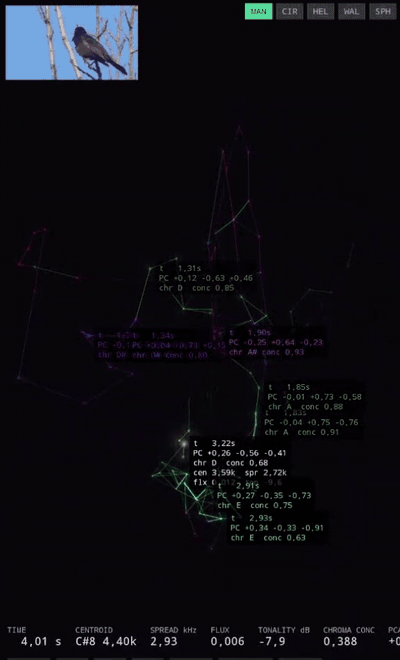
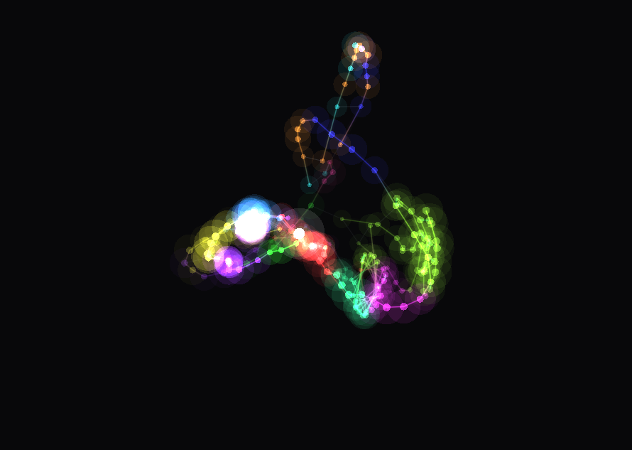
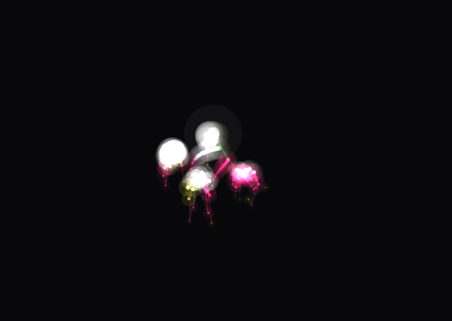
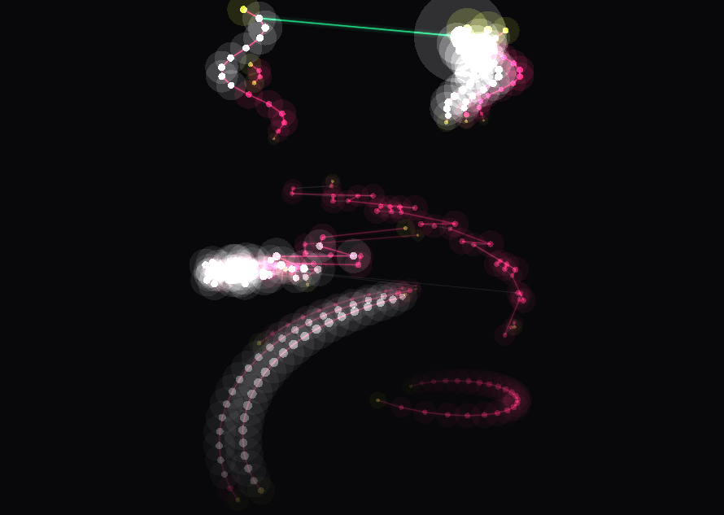
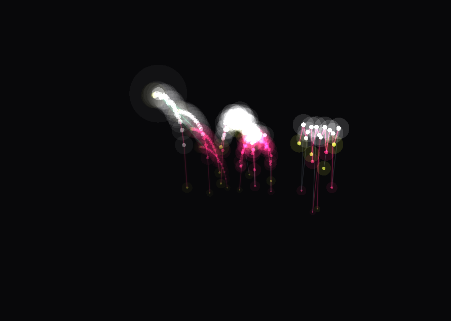

<p align="center">
  
</p>

<h1 align="center">BirdGraph</h1>

<p align="center">
  <b>Real-time 3D spectral graphs of bird vocalizations.</b><br>
  Python desktop app + native Android app. DSP written from scratch, no librosa.
</p>

<p align="center">
  
  
  
  
</p>

---

## What it does

Most bird-song visualizers draw a spectrogram. BirdGraph builds a **graph**: spectral
peaks become nodes, and they're connected by measurable relationships — partial
continuity, harmonic ratios, timbral proximity in a PCA-reduced MFCC space.

The result is a structure you can rotate, and — more usefully — a per-frame dataset
you can run statistics on.

| | |
|---|---|
|  |  |
| **manifold** — frames projected by PCA of their MFCCs. Green chords link moments that *sound alike* but are far apart in time: repeated motifs. | **circle** — time maps to radius, frequency to angle. Spectral spread opens and closes the ring. |
|  |  |
| **helix** — angle is pitch class, radius is octave, depth is time. Tonal song draws a helix; noise draws a cloud. | **wall** — x time, y log-frequency, z amplitude. The most legible one. |

A fifth layout, **sphere**, maps azimuth to pitch class and radius to node age.

---

## Why a graph instead of a spectrogram

A spectrogram shows you energy. A graph shows you **relationships**, and relationships
are what you can measure across recordings:

- **Partial tracking** (magenta) links peaks across consecutive frames within ~1
  semitone. This traces glissandos, vibrato and trills as continuous filaments.
- **Harmonic fan** (green) connects partials whose `f/f0` ratio falls within 6% of an
  integer. Tells tonal sources apart from broadband noise.
- **MST threads** (white) tie everything into one connected structure.
- **Manifold chords** link frames that are close in MFCC space but distant in time —
  a repeated-motif detector, which is exactly what makes bird song comparable between
  individuals and species.

---

## What you can extract

The CSV export gives you, frame by frame: spectral centroid, spread, flux, flatness
(tonality), chroma concentration, the full partial list, and the 3D PCA coordinates.

That's enough to:

- **Segment syllables automatically** — flux peaks mark transitions, chroma
  concentration separates tonal from noisy stretches.
- **Detect repeated motifs** — the manifold chords are literally this.
- **Compare individuals or species** — average signature, bandwidth, repetition rate.
- **Feed a classifier** — these are the standard features for species ID from audio.

It's a feature-extraction and visualization instrument, not a trained classifier. It
gets you to the dataset; the model is the step after.

---

## Quick start

### Python (desktop)

```bash
pip install numpy scipy pyqtgraph PyOpenGL PyQt5 opencv-python-headless sounddevice
# ffmpeg on PATH
```

Open `python/birdgraph_live.py`, set the path at the top, and run it. No CLI needed:

```python
VIDEO  = r"/path/to/bird.mp4"   # empty string opens a file picker
LAYOUT = "manifold"
FMIN, FMAX = 400.0, 9000.0
```

> Install `opencv-python-headless`, **not** `opencv-python` — the regular build ships
> its own Qt libraries and collides with PyQt5.

Offline modes, if you want stills or data instead of the live view:

```bash
python birdgraph.py song.wav --mode still --at 4.05 --out frame.png
python birdgraph.py song.wav --mode csv   --out features.csv
```

### Android

Open `android/` in Android Studio. Install **NDK** and **CMake** from SDK Manager →
SDK Tools. Requires API 26+ (GLES 3.0, float PCM in MediaCodec). Use a Gradle JDK
between 17 and 21.

Prebuilt APK in [Releases](../../releases).

---

## Architecture

```
ffmpeg / MediaCodec        →  mono float PCM
        ↓
STFT + parabolic interp    →  spectral peaks (sub-bin frequency)
mel filterbank + DCT-II    →  40 MFCCs + deltas
covariance eigendecomp     →  PCA to 3D
pitch-class folding        →  chroma + concentration
        ↓
graph construction         →  partial tracking, harmonic fan, MST
        ↓
additive-blended GL        →  the render
```

Everything is implemented by hand — no librosa, no Eigen. Not for purity: so the
pipeline is auditable coefficient by coefficient, and so it ports cleanly.

### Cross-verified implementations

The C++ DSP was compiled standalone and compared against the Python reference on the
same audio:

| metric | result |
|---|---|
| centroid, spread, flux, tonality, chroma concentration | correlation **1.000000** |
| max relative error | **~1e-4** (float32 precision) |
| spectral peaks detected | **3146 in both** |
| PCA explained variance | **22.3% / 18.0% / 12.3%**, identical |

| graph rebuild | Python | C++ |
|---|---|---|
| per frame | 1.7 ms | **0.13 – 0.21 ms** |

### Two decisions worth noting

**`glLineWidth` is capped at 1.0 on most GLES drivers.** So edges aren't drawn as
lines — each one is expanded into a camera-facing quad inside the vertex shader via
instanced rendering. That gives real width control plus the transverse gradient that
produces the glow.

**Zero per-frame allocations on Android.** The graph is built in C++ over reused
buffers and exposed to Kotlin as `DirectByteBuffer`. The renderer uploads straight to
GL — no garbage for the collector 60 times a second.

---

## Tuning

| parameter | default | what it changes |
|---|---|---|
| `fmin` / `fmax` | 400 / 9000 | analysis band. Koel 500–5000, goldfinch 1500–9000 |
| `fadeHalfLife` | 0.45 s | brightness decays as `0.5 ** (age / halfLife)` |
| `windowSec` | 1.2 s | visible span in peak layouts |
| `trailSec` | 6.0 s | manifold trail |
| `nodeHop` | 3 | 1 = dense and slow, 4–6 = light |
| `maxPeaks` | 7 | nodes per frame |

Nodes below `alphaCutoff` aren't just invisible — they're never built, so the fade
cleans the scene *and* lowers per-frame cost. When the bird stops singing, the trail
decays to nothing on its own.

---

## Credits

Inspired by the work of **Lucio Arese**, whose bird-song visualizations in
TouchDesigner started this. The implementation here — DSP, graph construction,
renderers, Android port — is my own.

Test audio from [xeno-canto](https://xeno-canto.org/) under Creative Commons.

## License

MIT — see [LICENSE](LICENSE).
